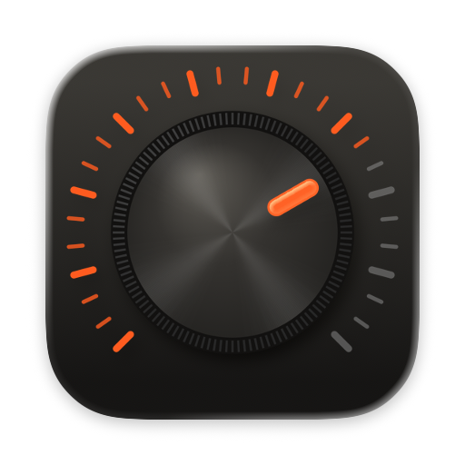
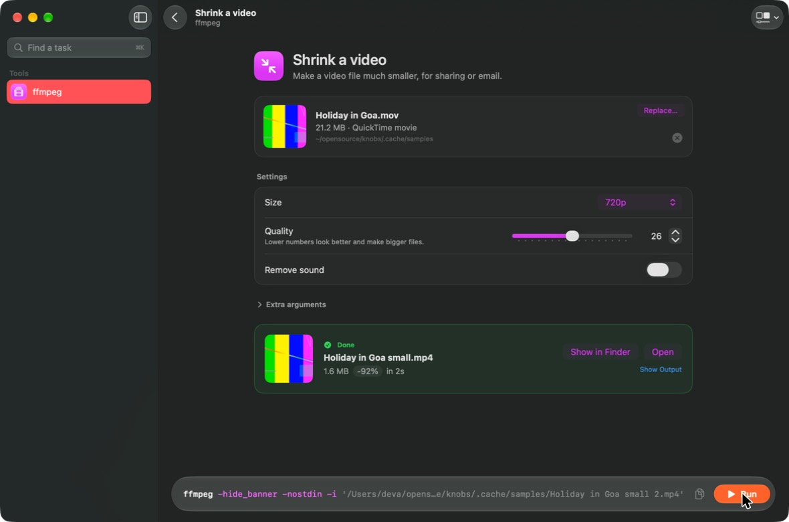

<p align="center">
  
</p>

<h1 align="center">Knobs</h1>

<p align="center">
  <strong>Command-line tools, as Mac windows.</strong><br>
  Pick a task, drop in a file, turn a few knobs, press Run. The exact command is always on screen.
</p>

<p align="center">
  
</p>

ffmpeg, yt-dlp, ImageMagick and their friends can do almost anything, if you remember the flags. Knobs puts
the everyday jobs behind plain controls, and shows you the real command as you change them. Nothing is hidden,
so you learn the tool while you use it.

Status: working toward v0.1.0. See [docs/PLAN.md](docs/PLAN.md) and [CHANGELOG.md](CHANGELOG.md).

## What it does

- **Tasks in plain words.** "Shrink a video", "Make a PDF searchable", "Remove the location". Drop a file,
  set what matters, press Run. Progress, Cancel, and a result card with Open, Show in Finder and drag-out.
- **The real command, live.** Every change updates the command bar, colored by part, ready to copy into
  Terminal.
- **Three layers per tool.** The tasks; an Extra arguments box on every task for anything else; and
  All options, every option the tool lists in its help, searchable, with a switch or field for each.
- **Add any tool.** Type the name of any command-line tool on your Mac and get an All options window for it.
- **Remembers you.** Settings stick per task, presets save the combinations you reuse, recent runs are one
  click away, and ⌘K reaches every task of every tool.
- **Safe by design.** Tools run as an argument list, never through a shell, so a strange file name is just a
  file name. Knobs never overwrites an existing file; it adds " 2", " 3" instead.

## Tools in the first release

| Tool | Tasks |
|---|---|
| ffmpeg | Shrink a video, Convert a video, Trim a clip, Extract the audio, Make a GIF, Remove the sound |
| yt-dlp | Download a video, Download just the audio, Download a whole playlist, Get the subtitles, Save the thumbnail |
| ImageMagick | Resize, Convert, Compress, Make it square, Add a text watermark, Rotate or flip |
| pandoc | Markdown to Word, Word to Markdown, Markdown to a web page, Make an ebook |
| ExifTool | Show hidden details, Remove all hidden details, Remove the location, Rename photos by date taken |
| OCRmyPDF | Make a PDF searchable, Straighten and clean a scan, Redo the text layer |
| Ghostscript | Compress a PDF, Merge PDFs, Convert to black and white, Extract pages |
| whisper.cpp | Transcribe to text, Make subtitles, Translate to English |
| rsync | Copy a folder, Mirror a folder, Compare two folders, Back up a folder |
| 7-Zip | Create an archive, Create a password-protected archive, Extract an archive, Check an archive |

Knobs doesn't install tools. If one is missing, it shows the `brew install` command to copy.

Each tool is a JSON manifest in [Manifests/](Manifests/), in the format documented in
[docs/MANIFEST_FORMAT.md](docs/MANIFEST_FORMAT.md). Adding a tool or a task needs no Swift; see
[CONTRIBUTING.md](CONTRIBUTING.md).

## Requirements

macOS 26 or later on an Apple Silicon Mac, and the tools you want to use (Homebrew is the easy way).

## Building from source

You need Xcode 26 or later and XcodeGen (`brew install xcodegen`).

```bash
scripts/install-hooks.sh
scripts/ci.sh
scripts/run-app.sh
```

All checks run locally on your Mac. This project uses no hosted CI.

## License

MIT. See [LICENSE](LICENSE). The tools Knobs runs belong to their authors and keep their own licenses.
